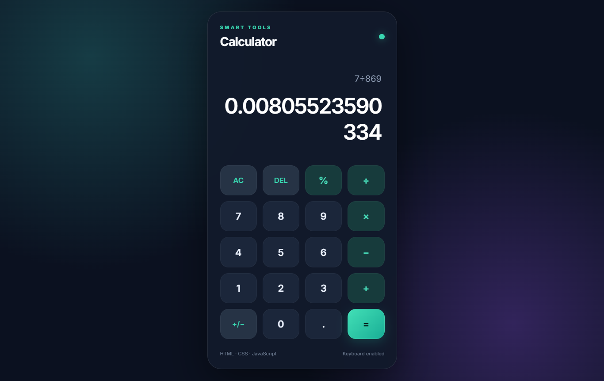

# 🧮 HorizonTechX Calculator

A modern, responsive calculator built with HTML, CSS, and JavaScript as part of the Horizon TechX Frontend Development Internship.

## 🚀 Live Demo

👉 https://sajjadursohag.github.io/HorizonTechX_Calculator/

## ✨ Features

- Addition, subtraction, multiplication, and division
- Percentage / remainder calculation
- Real-time result preview
- Clear All (AC) and Delete (DEL)
- Decimal and sign-change support
- Keyboard input support
- Responsive dark-themed interface
- Error handling for invalid calculations

## 🛠️ Technologies Used

- HTML5
- CSS3
- JavaScript (ES6)

## 📸 Screenshot

## 💻 Run Locally

1. Clone the repository:

   git clone https://github.com/sajjadursohag/HorizonTechX_Calculator.git

2. Open the project in VS Code.
3. Open `index.html` with Live Server.

## 👨‍💻 Author

Sajjadur Rahman

GitHub: https://github.com/sajjadursohag
